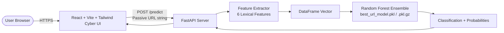

# URL Sentinel — Intelligent Malicious URL Detection

A production-grade, full-stack cybersecurity web application that performs real-time malicious URL classification using an empirical **Random Forest (Bagging)** ensemble model trained on 448,779 URLs.


-cyan)


---

## 1. System Architecture



> **Security Note:** URL Sentinel strictly treats all submitted URLs as passive text strings. It never resolves DNS, establishes socket connections to target hosts, or fetches external web content, preventing SSRF or malicious payload triggers.

---

## 2. Machine Learning Methodology & Verified Benchmarks

The core predictive engine is a **Random Forest Classifier** (`n_estimators=100`, `random_state=42`) trained under the Bagging (Bootstrap Aggregation) paradigm.

### Verified Experimental Benchmark Comparison
The ensemble pipeline was rigorously benchmarked against **AdaBoost (Boosting)** using a split of **448,779 training samples** and **96,167 held-out test samples**:

| Ensemble Model | Technique | Accuracy | Precision | Recall | F1-Score | ROC-AUC |
| :--- | :--- | :---: | :---: | :---: | :---: | :---: |
| **Random Forest** *(Selected)* | **Bagging (Bootstrap Aggregation)** | **79.58%** | **73.54%** | **60.23%** | **0.6622** | **0.8490** |
| **AdaBoost** | Boosting (Sequential Error Weighting) | 77.38% | 69.45% | 56.99% | 0.6261 | 0.8068 |

* **Selection Rationale:** Random Forest demonstrated superior generalization across all five evaluation metrics, reducing classification variance and outperforming AdaBoost by **+3.61% in F1-Score** and **+4.22% in ROC-AUC**.

### Extracted URL Features (6 Lexical Dimensions)
1. `url_length`: Total character length of the URL. Long URLs frequently camouflage subdomains or nested redirects.
2. `has_https`: Binary indicator (1 if URL begins with `https://`, 0 otherwise).
3. `has_ip`: Binary indicator (1 if host authority is an IPv4/IPv6 address, 0 otherwise). Direct IP URLs are characteristic of phishing and malware droppers.
4. `dot_count`: Frequency count of `.` characters in the URL string, identifying multi-level subdomain deception.
5. `hyphen_count`: Frequency count of `-` characters, commonly used in typosquatting and fake brand composition.
6. `keyword_count`: Frequency of matches against 17 credential and financial trigger tokens:
   `login`, `verify`, `update`, `secure`, `account`, `bank`, `signin`, `confirm`, `password`, `paypal`, `credential`, `authentication`, `wallet`, `suspend`, `recover`, `free`, `bonus`.

---

## 3. Technology Stack

* **Frontend**: React 18, Vite 6, Tailwind CSS 3, Lucide React icons.
* **Backend**: Python 3, FastAPI, Uvicorn (ASGI), Pydantic v2.
* **Machine Learning**: Scikit-learn 1.6.1, Joblib, NumPy, Pandas.
* **Deployment**: Render Cloud (Web Service / Static Site).

---

## 4. Project Structure

```text
malicious_url_project/
├── backend/
│   ├── main.py                 # FastAPI application, CORS, static mounting & routes
│   ├── schemas.py              # Pydantic request & response models
│   └── service.py              # Model artifact loading, inference singleton & caching
├── frontend/
│   ├── src/
│   │   ├── App.jsx             # Cyber-styled responsive dashboard
│   │   ├── main.jsx            # React root entrypoint
│   │   └── index.css           # Custom Tailwind cyber aesthetics & animations
│   ├── index.html              # HTML shell & font definitions
│   ├── package.json            # Frontend package manifest
│   ├── tailwind.config.js      # Cybersecurity theme extension
│   └── vite.config.js          # Vite build config & dev API proxy
├── best_url_model.pkl          # Trained Random Forest model (preserved original artifact)
├── best_url_model.pkl.gz       # Lossless compressed model (21.9 MB, GitHub-push safe)
├── model_config.pkl            # Model configuration, feature columns, and keyword list
├── feature_extractor.py        # Original URL feature extraction logic
├── requirements.txt            # Python dependencies
├── package.json                # Root package manifest with unified build scripts
├── render.yaml                 # Render infrastructure-as-code deployment configuration
├── .gitignore                  # Git ignore rules
└── README.md                   # Full documentation
```

---

## 5. Local Setup & Running

### Prerequisites
* Python 3.11, 3.12, or 3.13
* Node.js 18+ and npm

### Step 1: Clone Repository & Setup Virtual Environment
```bash
git clone <your-repo-url>
cd malicious_url_project

# Create virtual environment
python -m venv venv

# Activate virtual environment
# Windows:
.\venv\Scripts\activate
# Linux/macOS:
source venv/bin/activate

# Install dependencies
pip install -r requirements.txt
```

### Step 2: Build or Run Frontend
```bash
cd frontend
npm install
npm run dev
# Frontend dev server starts at: http://localhost:3000 (proxies API calls to port 8000)
```

### Step 3: Run FastAPI Backend
In a separate terminal (with virtual environment activated):
```bash
uvicorn backend.main:app --host 0.0.0.0 --port 8000 --reload
# API available at: http://localhost:8000
# Interactive Swagger Docs: http://localhost:8000/docs
```

### Step 4: Unified Production Mode (Optional)
To test the full application served from a single FastAPI server (exactly as it runs on Render):
```bash
# 1. Build frontend
cd frontend && npm run build && cd ..

# 2. Run backend
uvicorn backend.main:app --host 0.0.0.0 --port 8000
# Visit http://localhost:8000 in your browser to view the complete app
```

---

## 6. API Reference

### `GET /health`
Returns system status, model loading health, and library versions.
```json
{
  "status": "healthy",
  "model_loaded": true,
  "model_name": "Random Forest",
  "scikit_learn_version": "1.6.1",
  "features": ["url_length", "has_https", "has_ip", "dot_count", "hyphen_count", "keyword_count"]
}
```

### `GET /model-info`
Returns model hyperparameters, feature list, 17 keywords, and verified benchmark metrics.

### `POST /predict`
Analyzes a URL string and returns the ensemble prediction and feature breakdown.

**Request Payload:**
```json
{
  "url": "http://192.168.1.1/login-bank-account-verify.html"
}
```

**Response Payload:**
```json
{
  "url": "http://192.168.1.1/login-bank-account-verify.html",
  "predicted_class": 1,
  "label": "Malicious",
  "confidence": 0.8460,
  "probabilities": {
    "Legitimate": 0.1540,
    "Malicious": 0.8460
  },
  "features": {
    "url_length": 49,
    "has_https": 0,
    "has_ip": 1,
    "dot_count": 4,
    "hyphen_count": 3,
    "keyword_count": 4
  },
  "model_name": "Random Forest",
  "disclaimer": "This assessment is a statistical machine-learning prediction generated solely from lexical and syntactic URL characteristics..."
}
```

---

## 7. Render Deployment Guide

The project is pre-configured for **Render** via `render.yaml`. You can deploy using either of two recommended patterns:

### Option A: Unified Full-Stack Service (Recommended — 1 Free Instance)
In this mode, Render builds the React app into `frontend/dist` and FastAPI serves both the API and the SPA interface from a single URL.
1. Push your repository to GitHub.
2. In Render Dashboard, click **New +** &rarr; **Blueprint** &rarr; Connect your GitHub repository.
3. Render reads `render.yaml` and deploys `url-sentinel`.
4. Alternatively, create a **Web Service** manually:
   * **Runtime:** Python 3
   * **Build Command:** `cd frontend && npm install && npm run build && cd .. && pip install -r requirements.txt`
   * **Start Command:** `uvicorn backend.main:app --host 0.0.0.0 --port $PORT`
   * **Environment Variable:** `PYTHON_VERSION` = `3.11.9`

### Option B: Two-Service Deployment (Web Service Backend + Static Site Frontend)
1. **Backend Web Service (`url-sentinel-api`):**
   * **Build Command:** `pip install -r requirements.txt`
   * **Start Command:** `uvicorn backend.main:app --host 0.0.0.0 --port $PORT`
   * **Environment Variable:** `CORS_ALLOWED_ORIGINS` = `*` (or your static site URL)
2. **Frontend Static Site (`url-sentinel-ui`):**
   * **Build Command:** `cd frontend && npm install && npm run build`
   * **Publish Directory:** `frontend/dist`
   * **Environment Variable:** `VITE_API_URL` = `https://<your-backend-api>.onrender.com`

---

## 8. Academic Attribution & Security Disclaimer

* **Project Title:** Malicious URL Detection Using Ensemble Learning
* **Methodology:** Comparative analysis of Bagging (Random Forest) vs. Boosting (AdaBoost).
* **Disclaimer:** This software is an academic cybersecurity demonstration. Model predictions are generated solely through lexical feature extraction. For mission-critical environments, this system should be deployed as a supplementary layer within a broader defense-in-depth infrastructure (including DNS reputation filtering, TLS inspection, and sandbox execution).

